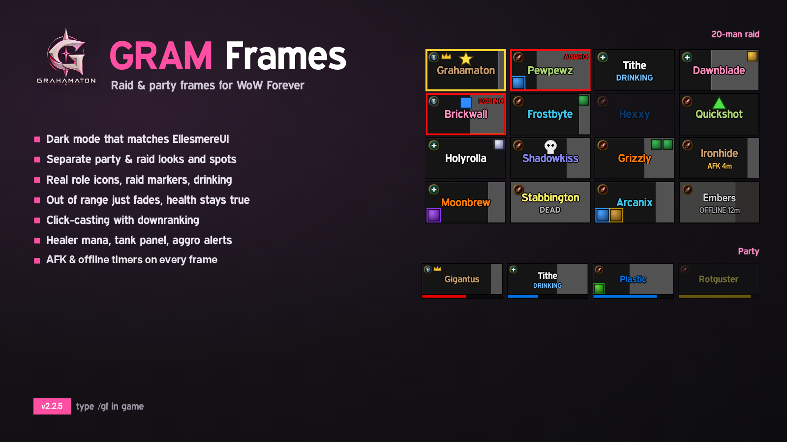
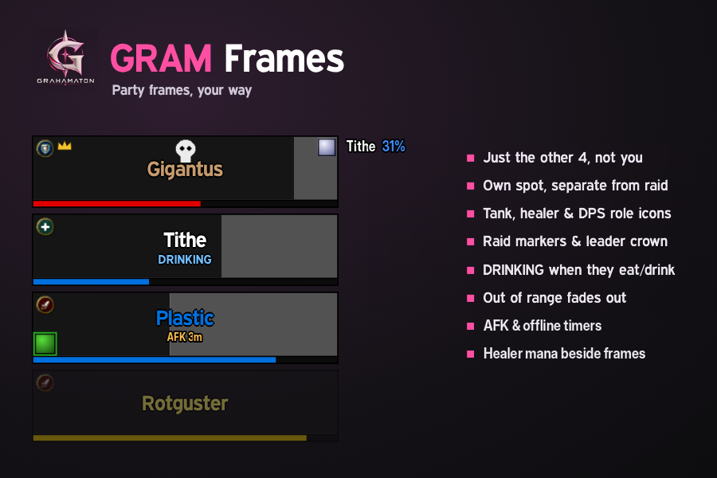
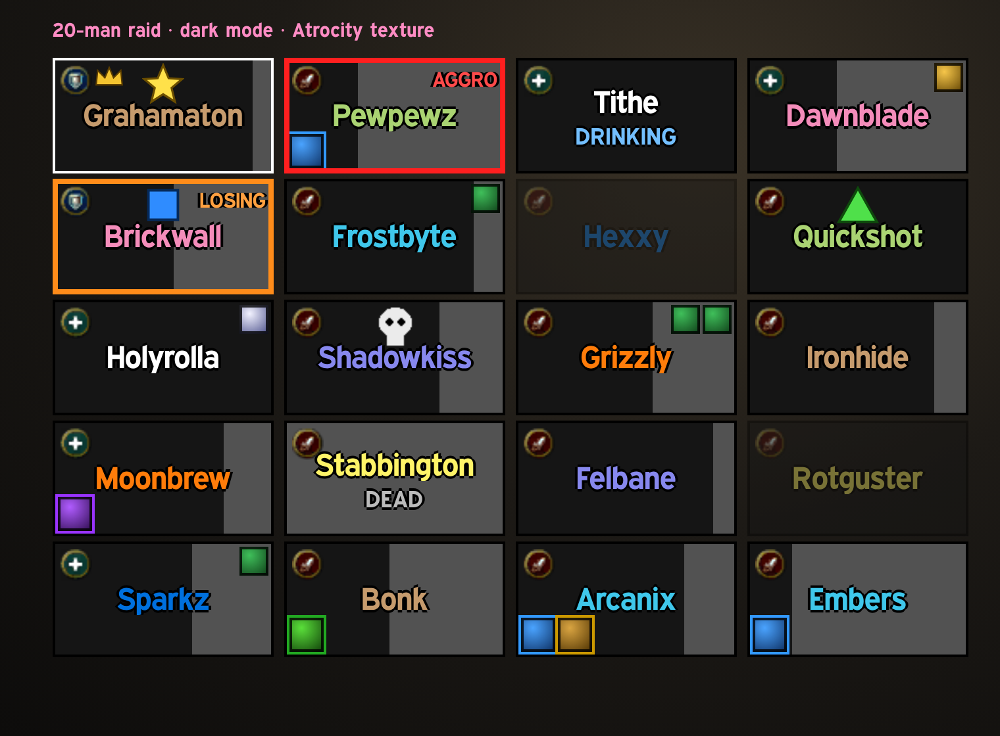
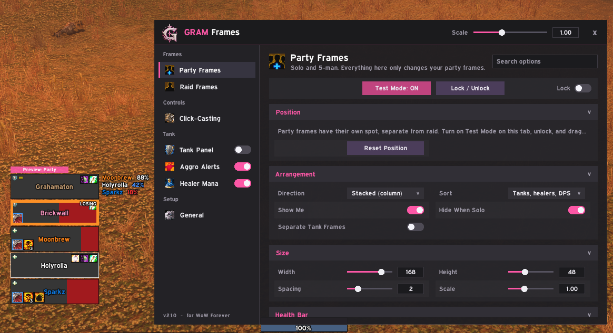

# Gram Frames

Dark, clean raid and party frames for **WoW Forever**, built from scratch for tanks and healers who want full control without the clutter.

**Version 2.1.8 (beta)** · Interface 16001 · type `/gf` in game

## Install

1. **[Download GramFrames.zip](https://github.com/jonathanwehman/gramframes/raw/main/GramFrames.zip)**
2. Unzip it into `World of Warcraft\_forever_\Interface\AddOns` so you get an `AddOns\GramFrames` folder.
3. Turn off any other raid frame addon you use.
4. Log in, type `/gf`, turn on Test Mode, drag the frames where you want, and lock them.

## Features

### Party and raid, separately
- Party Frames and Raid Frames each have their own tab, spot on screen, size, colors, buffs and debuffs
- 10, 20 and 40-man each get their own setup and switch automatically
- Party: your 4 groupmates (turn on "Show Me" to add yourself), stacked or side by side, hide when solo
- Raid: groups as columns (or rows), or one combined grid

### Looks
- Dark mode: grey bars, red missing health, class-colored names
- Pick your own bar and background colors, or use class colors or a healer health gradient
- Pick a bar texture: Blizzard's, any shared through LibSharedMedia, and EllesmereUI's if you run it
- "Match EllesmereUI": takes the dark-mode grey straight from EllesmereUI so everything matches
- Range fade, role and leader icons, raid markers, target highlight

### Click-casting with downranking
- Bind any modifier + mouse button to a spell, macro, target, assist, focus or menu
- Pick spells from a list of your class spells (heals first), with icons
- Choose **Max rank** or any specific rank for cheaper heals

### Healer Mana
- Every healer's name and mana % beside your frames
- White when fine, blue when getting low, red when nearly out; works in combat

### Buffs and debuffs
- Your HoTs and buffs top right, debuffs bottom left
- Blue edge on debuffs you can dispel, stack counts shown
- Uses Forever's built-in aura display, so it keeps working in dungeons and combat

### Tank tools
- Tank panel with each tank and what they're targeting (own spot for party and raid)
- Aggro alerts: colored border when someone else pulls threat

### Lightweight
Each frame only listens for updates about its own player, and one shared timer handles range checks.

## Commands

| Command | What it does |
| --- | --- |
| `/gf` | Opens the options window |
| `/gf test` | Shows fake frames so you can set up without a group |
| `/gf lock` | Locks or unlocks the frames (the pink drag bar hides when locked) |
| `/gf minimap` | Shows or hides the minimap button |
| `/gf debug` | Prints what the game reports for each frame (handy for bug reports) |

## Screenshots

## Font

Gram Frames uses the **Expressway** font if you already have it installed (for example through EllesmereUI). It isn't included here because it's a paid font; without it the frames use the default game font.

## Bugs

Install BugSack, then send the error (screenshot is fine) to Jon or open an issue here.

## Thank you

Big thanks to the authors of Cell, ElvUI, HealBot, EllesmereUI and every other frame addon that showed what great raid frames can be. Gram Frames is its own creation, made with a lot of respect for theirs.

Made by Jon (Grahamaton).
